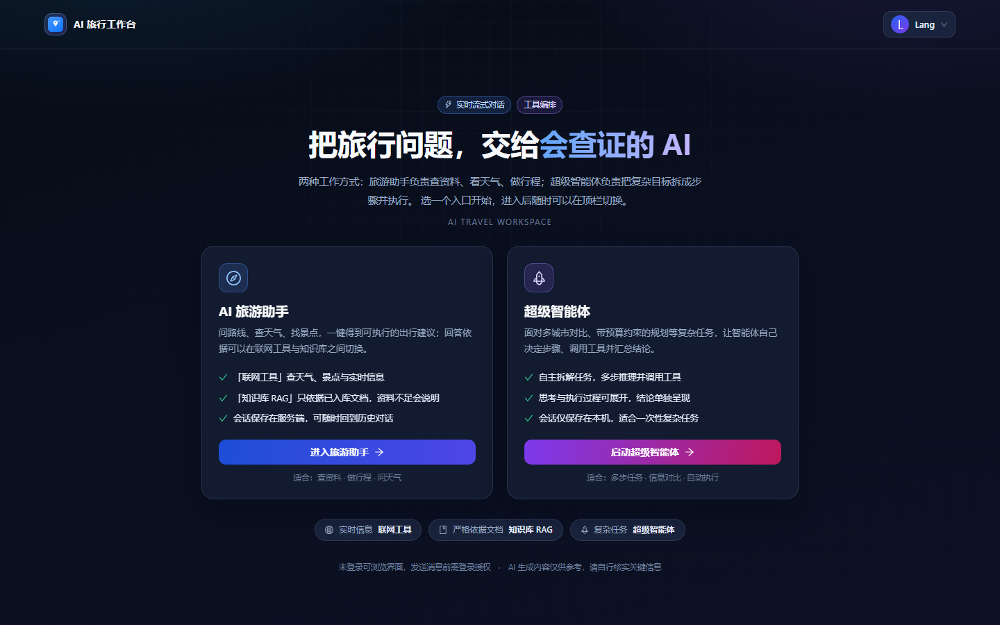
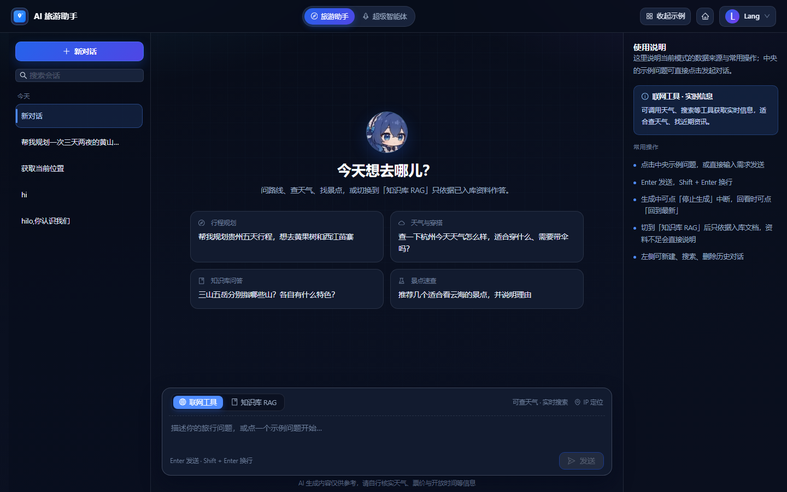
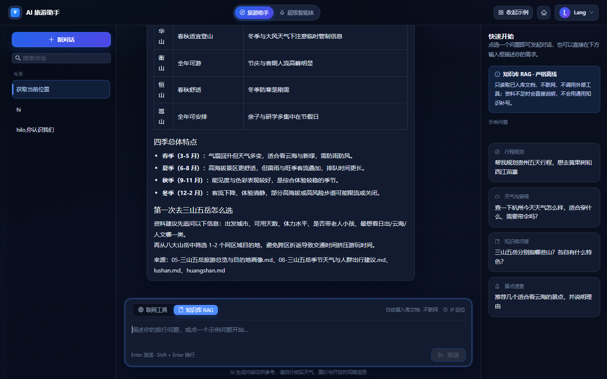
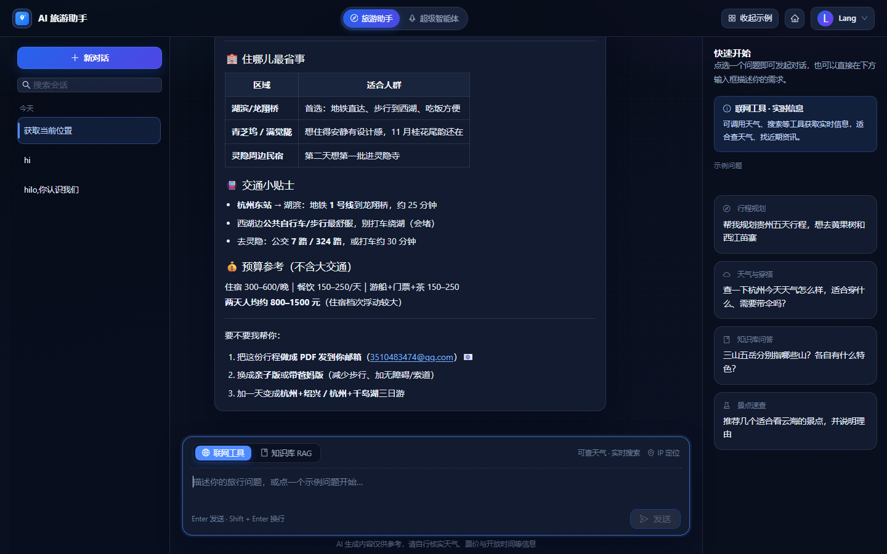
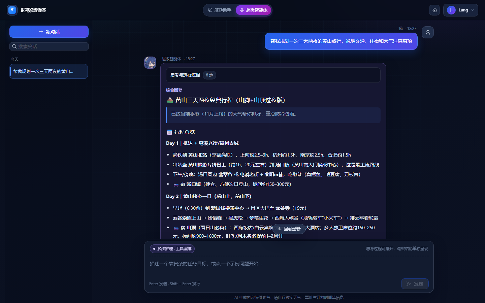
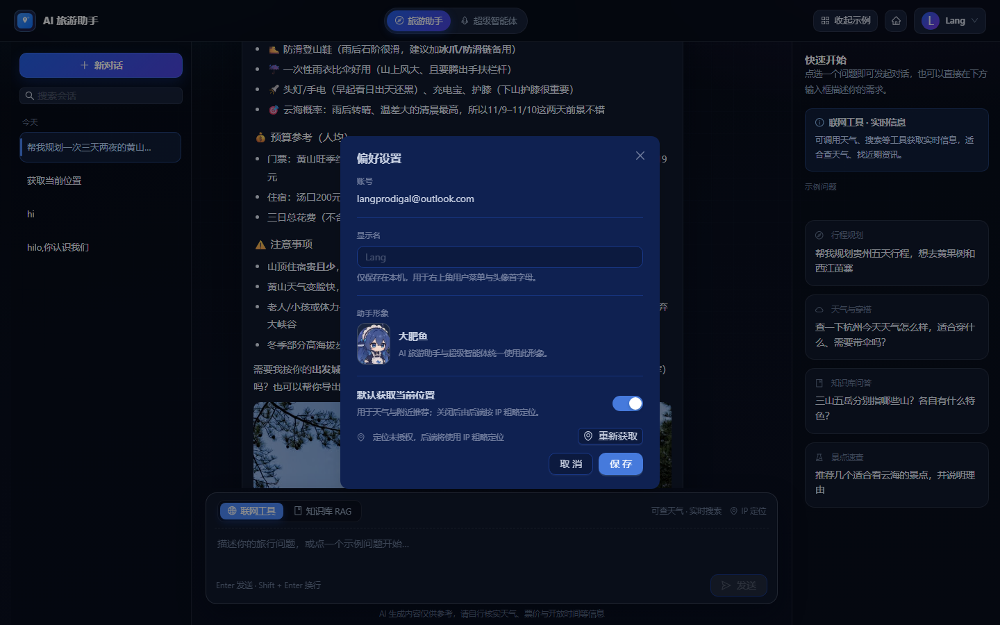

# AI 旅游助手

> 面向国内旅游场景的 AI 对话系统：**旅游助手**负责查资料、看天气、做行程；**超级智能体**把复杂目标拆成步骤并逐步执行。前后端一体化部署，Spring Boot API + Umi/React Web。
>
> 线上体验：<http://159.75.74.182/>

本文所有界面截图均取自**线上站点实拍**（2026-11-08，登录态，1440×900 / 390×844），存放于 [`docs/images/`](docs/images/)；`08-loading.png` 为本次首屏优化后的本地构建实拍。

---

## 1. 界面预览

### 首页与工作台

<p align="center">
  
  
</p>

<p align="center">
  <sub>左：模式选择首页　·　右：旅游助手欢迎页（大肥鱼形象 / 示例问题 / 右侧使用说明）</sub>
</p>

### 三种回答模式

<p align="center">
  
  
</p>

<p align="center">
  <sub>左：知识库 RAG，只依据入库文档并标注来源　·　右：联网工具，可查天气与实时搜索</sub>
</p>

<p align="center">
  
</p>

<p align="center">
  <sub>超级智能体：思考与执行过程折叠区（8 步）+ 独立的综合回复</sub>
</p>

### 偏好设置、移动端与首屏加载

<p align="center">
  
  
</p>

<p align="center">
  <sub>左：账号 / 显示名 / 助手形象 / 位置服务　·　右：390×844 移动端</sub>
</p>


---

## 2. 项目结构

| 路径 | 说明 |
|---|---|
| `prodigal-travel/` | 后端服务（Spring Boot 3.5 + Spring AI 1.1.2） |
| `prodigal-ai-mcp-server/` | 自研 stdio MCP 服务（图片搜索工具），纳入父 POM 聚合构建 |
| `prodigal-travel-web/` | 前端（Umi 4 + React 18 + Ant Design 5） |
| `prodigal-travel-web/nginx.conf` | 生产静态服务与 `/api` 反向代理（gzip / 缓存 / SSE） |
| `docs/OPTIMIZATION.md` | 架构优化、严格 RAG、SSE 协议、前端体验与历次验证记录 |
| `docs/images/` | README 用到的线上实拍截图 |
| `pom.xml` / `docker-compose.yml` | 父 POM 与单机前后端编排 |

## 3. 技术栈

**后端**：Java 21 · Spring Boot 3.5 · Spring AI / Spring AI Alibaba（DashScope、MiniMax、Ollama）· MyBatis-Plus + MySQL · Redis · pgvector（RAG）· Knife4j/OpenAPI · MCP stdio client

**前端**：Node.js ≥ 18 · Umi 4 · React 18 · Ant Design 5 · Axios + `fetch` SSE 流 · React Markdown + remark-gfm + rehype-sanitize

**部署**：Docker 多阶段构建 · nginx 1.27（静态资源 + `/api` 反代）

## 4. 核心能力

- **双模式对话**
  - `/chat/travel`：旅游助手，支持「联网工具」与「知识库 RAG」互斥切换
  - `/chat/manus`：超级智能体，结构化 SSE（`step` 步骤日志 / `delta` 综合回复 / `done` 结束）
- **严格 RAG**：仅检索 pgvector 中已入库文档，宽召回 + Java 层分数阈值过滤；无证据或证据不足固定拒答，不联网、不调用工具、不读会话记忆；答复仍写入 MySQL 便于刷新回看
- **流式输出与可中断**：打字机式渲染，生成中可「停止生成」，回看历史不会被强制拉到底部
- **会话与记忆**：请求级 `AgentRunContext` 存于 JVM；跨轮对话落 MySQL `chat_conversation` / `chat_message`，Redis 缓存最近 10 条
- **工具与 MCP**：搜索、天气、图片、时间、邮件、文件；MCP stdio 子进程按需接入
- **认证与偏好**：邮箱验证码注册、密码/验证码登录、退出、注销；显示名、助手形象、默认获取当前位置等本地偏好

完整设计与改造理由见 [docs/OPTIMIZATION.md](docs/OPTIMIZATION.md)。

## 5. 快速开始（本地开发）

### 前置要求

JDK 21 · Maven 3.8+ · Node.js 18+ · MySQL 8+ · Redis 6+ · DashScope API Key（必需）；可选 PostgreSQL + pgvector（RAG）、npx（高德 MCP）、RabbitMQ（欢迎邮件）。

所有密钥通过 `.env` / 环境变量注入，模板见 `.env.example`，变量说明见 [优化文档第 5 节](docs/OPTIMIZATION.md#5-配置密钥与-mcp-接入)。

### 启动后端

```bash
mvn -DskipTests package          # 根目录全量构建，同时产出 MCP server jar
cd prodigal-travel
mvn spring-boot:run
```

默认端口 `8088`、Context Path `/api`，激活 `local` profile。本地没有 npx 或 MCP jar 时设置 `SPRING_AI_MCP_CLIENT_ENABLED=false`。

### 启动前端

```bash
cd prodigal-travel-web
npm install
npm run dev
```

`config/config.ts` 将 `/api` 代理到 `http://localhost:8088`。开发服务器若 8000 被占用会自动落到 8001，以终端 `App listening at` 为准。

## 6. Docker 部署

```bash
cp .env.example .env       # 填写数据库、Redis、模型 Key、JWT Secret 等
docker compose up -d --build
```

| 服务 | 容器名 | 端口 | 说明 |
|---|---|---|---|
| `travel-backend` | `travel-backend` | `127.0.0.1:8088:8088` | 仅本机可直连，统一由 nginx 反代 |
| `travel-web` | `travel-web` | `80:80` | nginx 托管 `dist` 并代理 `/api` |

> `nginx.conf` 里的 `proxy_pass http://travel-backend:8088/api/` 必须与 compose 服务名一致；改名时两处同步，否则会 502。

运行状态检查：

```bash
docker compose ps
docker compose logs -f travel-backend
curl -X POST http://localhost:8088/api/health/check       # OK
curl -I  http://localhost/                                # 302 -> /entry
```