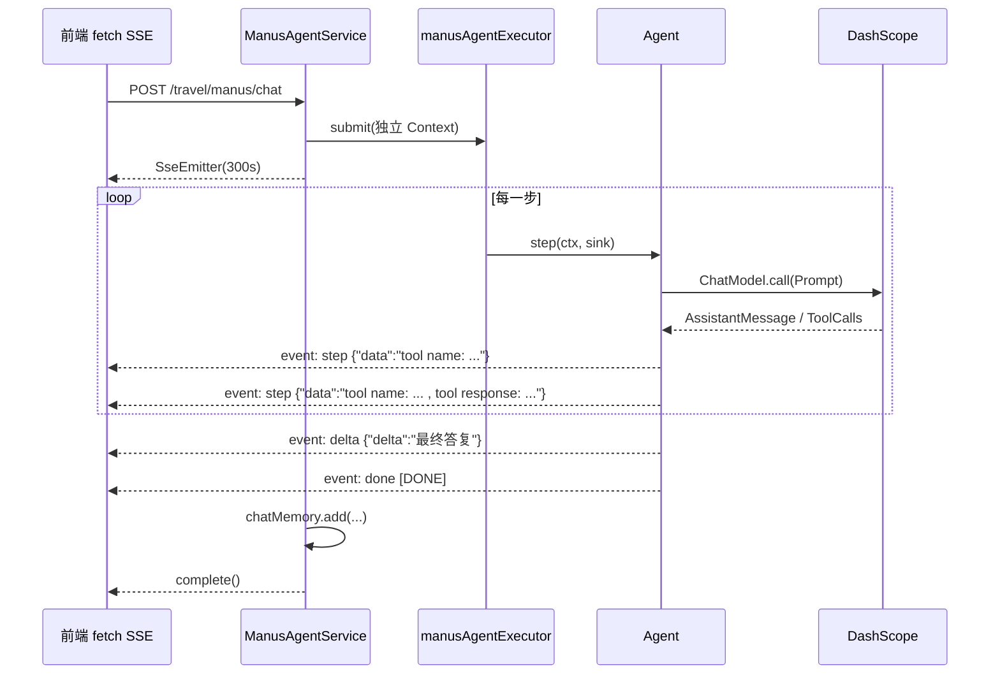

# Prodigal AI Travel 项目优化说明

> 版本：v1.0（2026-11-06）
> 范围：`prodigal-travel`（Spring AI 问答 + 超级智能体 Manus）、`prodigal-ai-mcp-server`（stdio MCP 服务）、`prodigal-travel-web`（SSE 消费）、构建与配置。
> 目标：修正「简易 Manus」的 ReAct 执行流程，理顺 Spring AI 问答 / RAG / MCP 链路，消除并发与安全隐患，并给出可验证的交付。

---

## 1. 优化结论速览

| 维度 | 优化前 | 优化后 |
|---|---|---|
| Agent 状态 | 挂在 Agent 对象字段上，`@Component` 单例 + `cleanup()` 空实现，跑一次后永远 `FINISHED` | 全部移入每次请求独立的 `AgentRunContext`，Agent 实例无请求级状态 |
| 循环终止 | 正常结束也会被追加「达到最大步骤」；异常被吞后空转 15 步 | 四重退出条件（完成 / 步数 / 时间 / 客户端取消），正常结束不误报 |
| 工具调用 | `act()` 重新 `new Prompt(...)` 丢掉工具定义；最后一条消息强转 `ToolResponseMessage` | 工具回调显式写入 `DashScopeChatOptions`，按类型查找工具响应，拦截重复调用 |
| 最终答复 | `doTerminate` / 空输出时可能只返回步骤日志 | 循环结束必生成最终答复（`onLoopEnd` 兜底总结） |
| 上下文 | 每步重复追加 `nextStepPrompt`；`ChatClient` 的 MemoryAdvisor 与手工 `messageList` 双重注入 | 系统提示只注入一次；Agent 直接用 `ChatModel` 管上下文；记忆由 `MySQLChatMemory` 统一承载 |
| 流式协议 | 单个 `String` + `<<<MANUS_TOOL_LOG>>>` 分隔符，前端按文本前缀猜类型 | SSE 命名事件 `step` / `delta` / `done`，data 统一 JSON 编码 |
| 线程模型 | `CompletableFuture.runAsync` 占用 `ForkJoinPool.commonPool` | 有界、隔离、可配置的 `manusAgentExecutor` |
| 会话记忆 | Manus 完全无记忆（每次请求新建 InMemoryChatMemory） | 复用 `userId:chatId` 的 MySQL/Redis 记忆，Manus 支持多轮 |
| Spring AI 问答 | 用户消息被复制进 system；RAG 把改写查询当成 user 消息；SSE 裸文本分片 | 系统/用户消息分离；显式 RAG 管线；Flux→SSE 安全桥接 + 取消订阅 |
| 安全 | 多处真实密钥明文写在配置/MCP JSON 中，`.env` 未被忽略 | 全部改为环境变量占位，`.env` 加入 `.gitignore`，给出轮换清单 |

---

## 2. 问题诊断清单

### P0 — 会导致功能错误 / 数据串台

| # | 位置 | 问题 | 影响 |
|---|---|---|---|
| P0-1 | `BaseAgent` | `state / messageList / currentStep / toolChatResponse` 是对象字段，`cleanup()` 为空，运行后不复位 | 单例 Bean 第二次调用直接抛 `Cannot run agent from state:FINISHED`；并发请求互相污染上下文 |
| P0-2 | `TravelAssistantController#chatManus` | 每次 `new ProdigalManus(...)`，同时类上又有 `@Component` | 单例 Bean 从未被使用；每请求重建 `ChatClient` 与 `InMemoryChatMemory`，多轮记忆丢失；`ToolCallbackProvider` 缺失时构造失败 |
| P0-3 | `ToolCallAgent#act` | `new Prompt(getMessageList(), chatOptions)`，而工具定义只在 `ChatClient.prompt(...).toolCallbacks(...)` 里注入过 | `ToolCallingManager` 解析不到 `ToolCallback`，工具调用链路不可靠 |
| P0-4 | `ToolCallAgent#act` | `(ToolResponseMessage) CollUtil.getLast(conversationHistory())` 强转 | 历史末尾不是工具响应时 `ClassCastException`，整个步骤失败 |
| P0-5 | `ToolCallAgent#think` | `catch` 后 `String.format("An error occurred during processing", e.getMessage())` 没有占位符，然后返回 `false` | 异常信息丢失，`ReActAgent#step` 返回占位文本且不改状态，循环空转到 `maxStep` |
| P0-6 | `TravelAiClient#buildMessageWithClientIp` | 返回 `message + ctx`，调用方又 `.system(SYSTEM_PROMPT + finalSystemPrompt)` | 用户输入被复制进系统区：token 翻倍、放大提示注入、模型可能把用户原话当系统指令 |
| P0-7 | `BaseAgent#runStream` | 正常结束时只要 `currentStep >= maxStep` 就追加「达到最大步骤」 | 用户看到的最终回复里混入错误提示 |

### P1 — 流程与健壮性

| # | 位置 | 问题 |
|---|---|---|
| P1-1 | `ToolCallAgent#think` | 每一步都把 `nextStepPrompt` 作为 `UserMessage` 追加，15 步就是 15 条重复指令，上下文膨胀 |
| P1-2 | `ProdigalManus` | 手工 `messageList` + `MessageChatMemoryAdvisor`（默认 conversationId）双份记忆，且所有用户共享一个内存窗口 |
| P1-3 | `ToolCallAgent` | 无工具调用且无正文时 `lastThinkEndedWithPlainAssistantText=false`，`state` 不变，空转；重复工具调用仅靠提示词约束 |
| P1-4 | `TerminateTool` / `doTerminate` | 判定用精确 `equals("doTerminate")`，MCP 工具名带前缀会失配；终止后不生成最终答复 |
| P1-5 | `BaseAgent#runStream` | `SseEmitter.send(String)` 无事件名；模型正文里出现分隔符会被误拆；实际代码里根本没有地方拼接 `TOOL_LOG_SEPARATOR`，前端「综合回复 / 步骤日志」分流基本失效 |
| P1-6 | `BaseAgent#runStream` | `CompletableFuture.runAsync` 使用公共线程池跑多次阻塞模型调用；无超时/取消；`onCompletion` 与 `finally` 重复 cleanup |
| P1-7 | `TravelAiClient#doChatWithRag` | `queryRewriter.doRewriteQuery()` 返回「原问题 + 改写查询」并直接当 `.user(...)`，聊天记忆保存的是改写后的问题；叠加 `MultiQueryExpander`（3 个查询变体）后又多一轮模型调用和多次检索 |
| P1-8 | `TravelAssistantController` 三处 SSE | `flux.subscribe(...)` 重复三遍；`sseEmitter.send(chunk)` 直接发裸文本（分片含换行会破坏 SSE 帧）；超时/断连不取消订阅；错误直接 `completeWithError`，前端拿不到可读提示 |
| P1-9 | `MySQLChatMemory` | `ensureConversation(parsed, messages.getFirst().getText())` 对空文本 NPE；`tool/function` 消息回放成 `AssistantMessage` 会破坏消息配对 |

### P2 — 配置、构建、安全

| # | 位置 | 问题 |
|---|---|---|
| P2-1 | `application-local.yml`、`mcp-servers-local.json`、`prodigal-ai-mcp-server/application-local.yml` | 大模型 Key、邮箱授权码、JWT 密钥、数据库口令、Pexels/高德 Key 明文落盘 |
| P2-2 | `.gitignore` | 忽略了 `application-local.yml` / `mcp-servers-local.json`，但**没有忽略 `.env`**（`git status` 显示 `.env` 为未跟踪文件，极易误提交） |
| P2-3 | `mcp-servers.json`（prod） | `env.AMAP_MAPS_API_KEY` 写死占位字符串，会覆盖容器注入的真实环境变量，导致高德 MCP 工具必然失败 |
| P2-4 | 根 `pom.xml` | `<modules>` 只有 `prodigal-travel`；MCP stdio 配置引用的 `prodigal-ai-mcp-server-0.0.1.jar` 不会被根构建产出 |
| P2-5 | MCP server 启动参数 | `-Dspring.ai.mcp.server.stdio=true` 与 `application.yml` 的 `profiles.active: local,sse`（其中 `stdio: false`）互相冲突，靠命令行优先级勉强生效 |
| P2-6 | `prodigal-travel-web/src/generated/api/auth.ts` | 引用不存在的 `API.SendRegisterCodeRequest`，`tsc --noEmit` 报错 |
| P2-7 | `application.yml` | `spring.profiles.active: ${SPRING_PROFILES_ACTIVE}` 无默认值；多数 `${XXX}` 无默认值，缺一个环境变量就无法启动 |

---

## 3. 优化后的架构与流程

### 3.1 分层职责

```
Controller (TravelAssistantController)
   ├── TravelAiClient          Spring AI 问答 / RAG / 工具 + MCP（ChatClient + Advisors）
   └── ManusAgentService       会话隔离、记忆读写、线程池调度、结构化 SSE
          └── ProdigalManus    无状态配置（提示词 / 步数 / 时间预算 / 工具集）
                 └── ToolCallAgent   手动 ReAct：think() 决策、act() 执行工具
                        └── ReActAgent / BaseAgent   循环骨架 + 退出条件
                               └── AgentRunContext   每次运行的可变状态
```

### 3.2 ReAct 主循环

```mermaid
flowchart TD
    A[POST /travel/manus/chat<br/>userId + chatId + message] --> B[ManusAgentService.stream]
    B --> C[chatMemory.get userId:chatId<br/>载入最近 N 条 user/assistant]
    C --> D[新建 AgentRunContext<br/>System → 历史 → 本次 User]
    D --> E{退出?<br/>FINISHED / 步数 / 时间 / 取消}
    E -- 否 --> F[think: ChatModel.call<br/>options 带 toolCallbacks]
    F --> G{返回 toolCalls?}
    G -- 有 --> H[emit TOOL_CALL 事件<br/>检查重复调用签名]
    H --> I[act: ToolCallingManager.executeToolCalls]
    I --> J[写回 conversationHistory<br/>emit TOOL_RESULT]
    J --> K{doTerminate?}
    K -- 是 --> E
    K -- 否 --> E
    G -- 无且正文非空 --> L[FINAL 事件 → event:delta<br/>state=FINISHED]
    G -- 无且正文为空 --> M[空转计数 +2 即退出]
    M --> E
    E -- 是 --> N{已有最终答复?}
    N -- 否 --> O[onLoopEnd: 不带工具再调用一次<br/>生成兜底最终答复]
    N -- 是 --> P[chatMemory.add user + assistant]
    O --> P
    P --> Q[event:done data:[DONE] → complete]
```

### 3.3 SSE 事件流



---

## 4. 关键改造说明

### 4.1 状态外置：从「有状态的单例」到「无状态执行器」

新文件 `agent/AgentRunContext.java` 承接全部请求级状态：`state / currentStep / messages / pendingResponse / finalAnswer / noProgressSteps / lastToolSignature / answerOnly / cancelled`，并提供 `shouldStop()`（完成、步数、墙钟时间、客户端取消四合一）。

`BaseAgent` 只保留 `name / systemPrompt / nextStepPrompt / maxStep / maxRunMillis / chatModel` 等配置；`run(...)` 每次创建或接收独立 Context，循环结束统一收敛状态。因此同一个 Agent 实例可以安全地服务任意多次、任意并发的请求（见 `ProdigalManusTest#contextIsIsolatedPerRun`）。

### 4.2 提示词与上下文

- `BaseAgent#mergeSystemPrompt()` 把 `nextStepPrompt` 合并进 **SystemMessage 且只注入一次**，替代旧版「每步追加一条 UserMessage」。
- `createContext()` 固定消息顺序：`SystemMessage → 历史 USER/ASSISTANT → 本次 UserMessage`；历史中的 `SYSTEM / TOOL` 消息被过滤，避免角色错位。
- Agent 直接调用 `ChatModel.call(Prompt)`，不再套 `MessageChatMemoryAdvisor`，彻底消除「手工 messageList + Advisor 注入历史」的双份上下文。

### 4.3 工具调用闭环

`ToolCallAgent#buildOptions(boolean withTools)` 构造 `DashScopeChatOptions`，显式 `setToolCallbacks(本地工具 + MCP 工具)`，并保持 `internalToolExecutionEnabled(false)`；`think()` 与 `act()` 使用同一份 options，`ToolCallingManager` 因此能解析并执行工具。

其它修正：

- `act()` 用 `findLastToolResponse(history)` 按类型倒序查找，不再强转最后一条消息。
- 连续两次 `工具名+参数` 完全相同的调用被拦截：补一条合法的 `ToolResponseMessage` 提示「不要重复调用」，并置 `answerOnly=true`，下一轮不再向模型暴露工具，强制其输出最终答复。
- `doTerminate` 用 `endsWith("doTerminate")` 兼容 MCP 工具名前缀；终止后由 `onLoopEnd()` 生成最终答复。
- `onLoopEnd()` 在达到步数/时间上限、异常、连续空转等场景下，用一次不带工具的模型调用整理兜底答复，**保证用户永远拿得到一段正文**。
- 工具日志统一截断到 800 字符，避免 SSE 帧与日志失控。

### 4.4 流式输出协议

`ManusStreamMarkers` 由字符串分隔符改为事件名常量。后端 `ManusAgentService#emit` 把 `AgentStepEvent` 映射为：

| 事件类型 | SSE event | data | 前端去向 |
|---|---|---|---|
| THOUGHT / TOOL_CALL / TOOL_RESULT / NOTICE / ERROR | `step` | `{"data":"..."}` | 「思考与执行过程」折叠面板 |
| FINAL | `delta` | `{"delta":"最终答复"}` | 「综合回复」正文 |
| DONE | `done` | `[DONE]` | 忽略（结束标记） |

data 全部 JSON 编码，模型输出里的换行被转义为 `\n`，不会再破坏 SSE 帧。前端 `manusStreamRouting.ts` 改为按 `kind` 分流（`delta`→正文、`step`→步骤、`message`→旧格式兼容分类），`travelChat.ts` 的 `mapManusEvent` 相应增加 `message` 类型。

`common/SseStreams.java` 把旅游助手 / RAG / MCP 三条 Flux 流统一桥接到 SseEmitter：JSON 包装分片、错误转可读提示、超时与断连取消 `Disposable`，消除三处重复 subscribe 代码。

### 4.5 Spring AI 问答与 RAG

`TravelAiClient` 重写：

- `baseSpec(message, chatId, systemSuffix, withTools)` 统一构造「系统提示 + 会话记忆 + 日志 Advisor + 本地工具 + MCP 工具」，各接口能力不再有隐性差异；`ToolCallbackProvider` 改为 `ObjectProvider` 可选注入，MCP 关闭时应用仍可启动。
- `buildClientContext()` 只产出系统上下文（IP / 经纬度 / 定位降级），不再把用户消息拼进 system。
- 加入 `SystemMessageFirstAdvisor`，保证 system 消息在历史消息之前（兼容 MiniMax 等厂商的消息顺序要求）。
- RAG 改为显式管线（后又按 4.8 收紧为严格知识库模式）：检索结果放进 **system 区** → `.user(原始问题)` → 流式生成。用户原始问题始终是 user 消息；去掉了 `MultiQueryExpander` 带来的额外模型调用与多次检索。
- 所有同步入口统一 `executeWithAlert`，流式入口统一 `doOnError` 告警。

### 4.6 会话记忆

`ManusAgentService` 现在用 `userId:chatId` 复用 `MySQLChatMemory`：运行前 `get()` 载入历史，成功后 `add(user + assistant)` 落库；记忆读写异常只告警、不阻断问答。`MySQLChatMemory` 同时修复了空标题 NPE、以及 `tool/function` 消息被错误回放为助手正文的问题。

### 4.7 线程池

`config/AgentExecutorConfig.java` 提供 `manusAgentExecutor`（默认 6 线程、48 有界队列、CallerRunsPolicy），参数 `PRODIGAL_AGENT_POOL_SIZE` / `PRODIGAL_AGENT_QUEUE_CAPACITY` 可调，Agent 的阻塞式模型调用不再占用 `ForkJoinPool.commonPool` 或 Servlet 请求线程。

### 4.8 RAG 严格知识库模式（2026-11-08 追加）

**问题**：在「RAG 问答」模式下问「拉萨」，知识库（`prodigal-travel/src/main/resources/rag/*.md`）只有故宫、恒山、桂林漓江、西湖、衡山、黄山、华山、庐山、三亚亚龙湾、泰山、兵马俑、雁荡山、嵩山共 13 篇指南，并没有拉萨，但界面仍输出了布达拉宫、大昭寺、最佳季节等完整攻略。原因有三层：

1. `buildRagSystemContext()` 在检索不到资料时返回的是「请基于**通用旅游知识**谨慎回答」，等于主动放行模型自由发挥；
2. RAG 复用了同一个 `chatClient`，它挂着 `MessageChatMemoryAdvisor`（历史里可能含此前联网搜索得到的答案），且 `TravelConstant.SYSTEM_PROMPT` 本身鼓励「熟悉国内目的地」「天气用 getWeather」「主动补图片」，把通用知识与工具倾向带进了 RAG；
3. `QueryRewriter` 用 `RewriteQueryTransformer` **调用大模型改写查询**，建库阶段 `TravelKeywordEnricher` 也调模型生成关键词——检索链路存在额外外部调用；相似度阈值仅 `0.3`，几乎任何片段都能被召回。

**改造**（`rag` 包 + `TravelAiClient`）：

| 环节 | 之前 | 现在 |
|---|---|---|
| 查询改写 | LLM `RewriteQueryTransformer` | `QueryRewriter` 纯本地规整（剥口语前缀/折叠空白/限长），零外部调用 |
| 检索 | `topK=5, threshold=0.3`（阈值下推 SQL） | `RagKnowledgeRetriever`：**SQL 宽召回 topK=5（不设绝对阈值）**，应用层按 `Document.getScore()` 过滤（默认 0.35），日志打印分数分布 |
| 相关性 | 无 | 中文二字词主题校验，拦截「问拉萨、召回黄山」；可用 `PRODIGAL_RAG_KEYWORD_GUARD=false` 关闭 |
| 无证据 | 提示模型用通用知识作答 | **直接返回固定拒答，连生成模型都不调用**（用 `Optional` 包装，避免 `Mono.fromCallable` 返回 null 变成空流） |
| 生成模型输入 | 通用 system 提示 + 历史记忆 + 可能带工具 | 独立 `ragChatClient`（无记忆 Advisor、零工具）+ `RAG_STRICT_SYSTEM_PROMPT`（唯一事实来源、禁止联网/常识补充/编造） |
| 建库关键词 | LLM `KeywordMetadataEnricher` | `TravelKeywordEnricher` 从标题与正文本地提取，不写知识库原文之外的词 |

检索片段自带 `filename` 来源标注，便于答案注明出处。RAG 模式**生成阶段不读会话记忆**（`ragChatClient` 无记忆 Advisor），避免历史答案被当作事实依据；流结束后会写入本轮问答用于留存，详见下节「会话留存」。当前链路唯一的外部调用只剩最终生成模型。

**检索结果如何整合并渲染**（有证据时的正常分支）：

1. `RagKnowledgeRetriever` 把最多 5 个通过阈值的分块拼成一段证据，逐块编号 `[资料N | 来源: xxx.md]` 并标注「唯一事实来源」；
2. `TravelAiClient.doChatWithRag()` 把证据放进 `system` 区、原始问题放进 `user`，交给 `ragChatClient.prompt().stream().content()`；模型会对多块资料做**归纳、去重、按主题重排**，用小标题 / 列表 / 表格输出，但不得引入原文之外的任何事实；
3. 文本分片经 `SseStreams.fromFlux()` 用 Jackson 序列化成 `{"delta":"..."}`（换行被转义，不会破坏 SSE 帧），前端 `streamRagAnswer` → `parseEventPayload()` 还原换行 → `appendAssistantDelta()` 累积 → `MessageList` 的 `ReactMarkdown`（`remark-gfm` + `rehype-sanitize`）渲染，支持标题、列表、粗体、表格与图片链接。

两条拒答路径文案已统一：无证据时上层短路返回 `RAG_NO_RESULT_ANSWER`；召回片段但资料不足时，`RAG_STRICT_SYSTEM_PROMPT` 内嵌同一份拒答语，要求模型原样输出，不再出现自拟措辞。多行拒答文案已验证经 JSON 转义 / SSE 传输 / 前端解析后换行完整。

**会话留存（只写不读）**：流正常结束后，`TravelAiClient.saveRagTurn()` 把「原始问题 + 完整答复」按 `UserMessage` / `AssistantMessage` 写入 `MySQLChatMemory`（与 Manus / 普通问答同一套 `userId:chatId` 表和 Redis 缓存），因此刷新首屏或切换会话时能回看 RAG 问答，切换模式上下文也连贯。实现要点：

- 用 `doOnNext` 累积分片、`doOnComplete` 才落库；异常、超时、客户端断开不会写入半截答案；
- 写库是阻塞 IO，放到 `Schedulers.boundedElastic()` 异步执行，失败只告警、不影响已完成的流式响应；
- **生成侧仍然不读记忆**：`ragChatClient` 没有记忆 Advisor，写入的历史不会回灌成下一次 RAG 的事实依据，严格知识库约束不变；
- 无证据的固定拒答同样落库（前端显示了这一轮，后端历史保持一致）。

**边界**：RAG 模式禁用工具且知识库 `*.md` 目前不含图片与表格，因此实际渲染以文字（标题 / 列表 / 粗体）为主；无证据时是 `Flux.just(...)` 一次性整段返回，能正常渲染但没有打字机效果；落库依赖 MySQL / Redis 可用，两者异常时仅记录告警。

**可调参数**（`application.yml` / `.env.example`）：`PRODIGAL_RAG_SIMILARITY_THRESHOLD`（默认 **0.35**，误拒答就调低、越界回答就调高）、`PRODIGAL_RAG_TOP_K`（默认 5）、`PRODIGAL_RAG_KEYWORD_GUARD`（默认 true）。三个参数在 `RagKnowledgeRetriever` 中改用 `@Value("${prodigal.rag.xxx:默认值}")` 声明式字段注入（与 `ToolRegisterConfig` 一致），不再在构造函数里手工调用 `Environment.getProperty()`；占位符默认值 + 字段初始化值双重兜底，脱离 Spring 容器手动构造时也不会退化成 `0.0 / 0 / false`。后端日志会打印 `RAG 检索: query=..., 召回=N, scores=[...], 阈值过滤后=M, threshold=..., topK=...`，可直接确认是否真的查了知识库、以及真实相似度分布。

**为什么阈值不再下推到 SQL（零召回故障修复）**：Spring AI 的 `PgVectorStore` 把 `similarityThreshold` 翻译成 `WHERE embedding <=> ? < 1 - threshold`。设 0.65 就是 `distance < 0.35`；而「泰山」这类短问题与长文档分块属于跨文体检索，余弦相似度天然偏低——实测同一篇文档的两个分块之间也才约 0.67（distance 0.33），问题查文档只会更低，于是 SQL 把候选全部挡掉，`similaritySearch()` 直接返回 0 行，日志表现为 `召回=0`，应用层的阈值过滤与主题词守卫根本没机会执行，前端只能拿到固定拒答。现改为 `SearchRequest.similarityThresholdAll()`：SQL 只按距离取最近的 `topK` 条，阈值判断留在应用层，默认门槛降到 0.35，并打印 `scores` 便于按真实分布校准。

**零召回排查顺序**（改后仍不命中时）：

1. 看日志：`召回=0` → 检查 pgvector 连接、表是否有数据、查询向量是否可用；`召回>0 但 scores 都很低且彼此接近` → 多半是**库内向量与当前 embedding 模型不同源**（例如由旧模型或另一批语料灌入），需清空表后让 `TravelKnowledgeLoader` 用当前 `text-embedding-v2` 重新灌库；
2. 核对来源与维度：`SELECT coalesce(metadata::jsonb->>'filename','<none>'), count(*) FROM public.travel_vector_store GROUP BY 1 ORDER BY 1;` 与 `SELECT min(vector_dims(embedding)), max(vector_dims(embedding)) FROM public.travel_vector_store;`（应为 1536）；
3. 若文件名与当前 `rag/*.md` 的 13 篇不一致，说明库里是旧批次数据，`TRUNCATE TABLE public.travel_vector_store;` 后重启服务重建（**该操作会清空知识库，请先确认可重建**）；
4. 阈值按日志 `scores` 校准，不要凭直觉调高。

> 前端在选中「RAG 问答」时显示「仅依据知识库作答，不联网」提示。若要在 IDEA 中核对向量库内容，可执行：
> `SELECT count(*) FROM public.travel_vector_store WHERE content ILIKE '%拉萨%' OR content ILIKE '%布达拉宫%';`
> 本次从工作机连接远程 pgvector 超时，未能代跑该 SQL，但已从 13 个 `rag/*.md` 源文件确认知识库范围。

---

## 5. 配置、密钥与 MCP 接入

### 5.1 密钥治理（重要）

以下内容**曾经以明文出现在仓库工作区文件中**，本次已全部改为 `${ENV_VAR:}` 占位：

- `prodigal-travel/src/main/resources/application-local.yml`：MiniMax / DashScope API Key、邮箱账号与授权码、JWT 密钥、数据库口令、SearchApi / 高德 / Pexels / 百度 Key、告警收件人等；
- `prodigal-travel/src/main/resources/mcp-servers-local.json`：高德 MCP Key；
- `prodigal-ai-mcp-server/src/main/resources/application-local.yml`：Pexels Key；
- `prodigal-travel/src/main/resources/mcp-servers.json`：`AMAP_MAPS_API_KEY` 固定占位值。

> **必须执行**：这些密钥既然曾明文落盘（且部分文件可能曾进入过历史提交），请在对应平台**轮换**所有 Key / 授权码 / JWT Secret，并检查 `git log -p` 是否曾有提交记录。之后一律通过 `.env` / 部署平台密钥管理注入。`.env` 已加入 `.gitignore`，仓库只保留 `.env.example` 模板。

### 5.2 环境变量清单

完整模板见仓库根目录 `.env.example`。关键分组：

| 分组 | 变量 |
|---|---|
| 运行环境 | `SPRING_PROFILES_ACTIVE`（默认 `local`）、`TZ` |
| 数据库 | `SPRING_DATASOURCE_URL/USERNAME/PASSWORD`、`SPRING_DATA_REDIS_*`、`POSTGRESQL_HOST/USERNAME/PASSWORD`（或 `POSTGRESQL_URL`）、`RABBITMQ_*` |
| 模型 | `MINIMAX_API_KEY`、`MINIMAX_CHAT_MODEL`、`DASHSCOPE_API_KEY`、`DASHSCOPE_CHAT_MODEL`、`DASHSCOPE_ENABLE_THINKING` |
| 工具 | `PRODIGAL_SEARCH_API_API_KEY`、`PRODIGAL_AMAP_API_KEY`、`PRODIGAL_PEXELS_API_KEY`、`PRODIGAL_BAIDU_APP_ID/API_KEY` |
| MCP | `SPRING_AI_MCP_CLIENT_ENABLED`、`SPRING_AI_MCP_CLIENT_REQUEST_TIMEOUT`、`MCP_AMAP_COMMAND`、`PRODIGAL_MCP_SERVER_JAR` |
| Agent | `PRODIGAL_AGENT_POOL_SIZE`、`PRODIGAL_AGENT_QUEUE_CAPACITY` |
| 其它 | `PRODIGAL_JWT_SECRET`、`PRODIGAL_*_ALERT_*`、`SPRING_MAIL_*` |

所有占位符都带默认值，缺少单个环境变量不再导致启动失败；`REDIS_*` / `AI_ALERT_*` 等旧别名仍兼容。

### 5.3 MCP 接入流程（修正后）

1. 根 `pom.xml` 已把 `prodigal-ai-mcp-server` 纳入 `<modules>`，`mvn package` 会同时产出 `prodigal-ai-mcp-server/target/prodigal-ai-mcp-server-0.0.1.jar`。
2. **本地**：`application-local.yml` 使用 `spring.ai.mcp.client.stdio.connections`（Spring Boot 配置绑定会解析 `${...}` 占位符），不再引用含明文 Key 的 JSON：
   - `amap-maps`：`npx.cmd`（Linux 设 `MCP_AMAP_COMMAND=npx`），`env.AMAP_MAPS_API_KEY=${PRODIGAL_AMAP_API_KEY}`；
   - `prodigal-ai-mcp-server`：`-Dspring.profiles.active=stdio,local` + `-jar ${PRODIGAL_MCP_SERVER_JAR}`，`env.PRODIGAL_PEXELS_API_KEY` 显式传入。
3. **MCP server 侧**：`application.yml` 的 profile 可被 `-Dspring.profiles.active` 覆盖；`stdio` profile 内已包含 `stdio:true`、`web-application-type:none`、`banner-mode:off`，不再靠命令行参数与 `sse` profile 打架；Pexels Key 走环境变量。
4. **生产**：`mcp-servers.json` 不再写 `env`，由容器继承 `AMAP_MAPS_API_KEY`（`docker-compose.yml` 已从 `.env` 注入），避免固定值覆盖真实密钥。
5. 本地缺少 `npx` 或 MCP jar 时，设 `SPRING_AI_MCP_CLIENT_ENABLED=false`；`ToolCallbackProvider` 已改为可选注入，关闭 MCP 不影响主链路启动。

> `mcp-servers-local.json` 保留为参考文件（已被 `.gitignore` 忽略、当前不再被引用）。若改回 `servers-configuration` 指向它，需由启动脚本替换其中的 `${...}` 占位符。

---

## 6. 验证结果

| 验证项 | 命令 | 结果 |
|---|---|---|
| 后端 + MCP server 编译 | `mvn -o -pl prodigal-travel test-compile`（JDK 21） | 通过 |
| Agent + 配置绑定 + 注入 + RAG 严格模式与零召回修复回归测试 | `mvn -o -pl prodigal-travel test -Dtest='ProdigalManusTest,McpStdioConfigBindingTest,TravelAiClientInjectionTest,RagKnowledgeRetrieverTest'` | 24/24 通过 |
| 全量打包（含两模块） | `mvn -DskipTests package`（离线/在线均通过） | 通过 |
| 前端类型检查 | `cd prodigal-travel-web && ./node_modules/.bin/tsc --noEmit` | 通过（顺带补齐 `API.SendRegisterCodeRequest` 类型别名） |
| 配置文件语法 | js-yaml 解析全部 7 个 `application*.yml` | 全部通过 |
| 明文密钥扫描 | `git grep` 扫描被跟踪文件 | 无残留 |

> 本机默认 `java` 为 JDK 11、Maven 运行在 JDK 17，项目要求 **Java 21**。验证时使用 `JAVA_HOME=D:/environment/jdk/ms-21.0.7`。

### 启动期依赖注入故障修复（2026-11-08 追加）

**现象**：打包后的 `app.jar` 启动失败，`travelAiClient` 创建 Bean 时抛
`BeanNotOfRequiredTypeException: Bean named 'pgVectorStore' is expected to be of type 'org.springframework.beans.factory.ObjectProvider' but was actually of type 'PgVectorStore'`。

**根因**：`PgVectorStoreConfig#pgVectorStore()` 产出的 Bean 名就是 `pgVectorStore`；而 `TravelAiClient` 里写的是
`@Resource private ObjectProvider<VectorStore> pgVectorStore;`。`@Resource` 是 JSR-250 **按字段名/Bean 名**注入，
Spring 执行 `getBean("pgVectorStore", ObjectProvider.class)`，把真实的 `PgVectorStore` 硬转成 `ObjectProvider` 而失败。
`ObjectProvider` 属于 Spring 的特殊依赖类型，只能由按类型注入（`AutowiredAnnotationBeanPostProcessor` / 构造器参数）解析。

**修复**：

1. `TravelAiClient`：两个 `ObjectProvider`（`VectorStore`、`ToolCallbackProvider`）改为**构造器参数按类型注入**并设为 `final`；
   字段重命名为 `vectorStoreProvider`，不再与任何 Bean 名冲突。其余 `@Resource` 依赖保持不变（尤其 `ToolCallback[] allTools` 依赖按名命中 `allTools` Bean）。
2. `AIClient`：`@Resource ObjectProvider<ToolCallbackProvider>` 改为 `minimaxAiClient(...)` 的**方法参数注入**，消除同类隐患。
3. 新增 `resolveVectorStore()`：无向量库时返回 `null`（RAG 给出可读错误），存在多个 `VectorStore` 实现时捕获
   `NoUniqueBeanDefinitionException` 并取排序最前的实例，避免 RAG 接口直接 500。
4. 新增 `TravelAiClientInjectionTest`（纯 `AnnotationConfigApplicationContext` + Mockito，不连外部服务）：
   复现「同名 `pgVectorStore` Bean + ObjectProvider」组合验证容器可刷新，并覆盖多向量库 Bean 与 `ManusAgentService` 的 `ToolCallback[]` 数组注入。

> 注意：该回归测试验证的是**依赖注入语义**，不等价于完整 `@SpringBootTest`；真实启动仍需按 `.env.example` 提供 MySQL / Redis / pgvector / 大模型 Key。

### 手工冒烟验证（需真实环境变量）

```bash
# 1) 启动后端（先按 .env.example 配好 .env，并确保 MySQL/Redis 可用）
mvn -pl prodigal-travel spring-boot:run

# 2) 旅游助手流式问答
curl -N -X POST http://localhost:8088/api/travel/chat/sse_emitter \
  -H 'Content-Type: application/json' \
  -H 'Authorization: Bearer <token>' \
  -d '{"message":"黄山的门票和最佳季节","chatId":"demo-1"}'

# 3) 超级智能体：观察 step / delta / done 三类事件
curl -N -X POST http://localhost:8088/api/travel/manus/chat \
  -H 'Content-Type: application/json' \
  -H 'Authorization: Bearer <token>' \
  -d '{"message":"帮我查一下杭州天气，再推荐两个适合下雨去的景点","chatId":"demo-manus-1"}'
```

预期 SSE 帧：

```
event: step
data: {"data":"tool name: getWeather , tool arguments: {\"city\":\"杭州\"}"}

event: step
data: {"data":"tool name: getWeather , tool response: ..."}

event: delta
data: {"delta":"杭州今天……（最终答复）"}

event: done
data: [DONE]
```

检查清单：

1. 连续请求两次 `/manus/chat`，第二次不应出现「无法从状态运行代理」或串入上一次的上下文；
2. 前端「综合回复」只显示最终答复，「思考与执行过程」只显示工具日志；
3. 日志中出现 `Agent 工具数：N（本地 X / MCP Y）`，确认 MCP 工具已合并；
4. 同一个 `chatId` 追问「那第二天呢」，Manus 应能复用历史；
5. 断开 SSE 连接后，服务端日志应很快停止新的 step（cancelled 生效）。

---

## 7. 变更文件清单

**新增**

| 文件 | 作用 |
|---|---|
| `prodigal-travel/.../agent/AgentRunContext.java` | 每次运行的独立状态 |
| `prodigal-travel/.../agent/AgentStepEvent.java` | 结构化步骤事件 |
| `prodigal-travel/.../config/AgentExecutorConfig.java` | Agent 专用线程池 |
| `prodigal-travel/.../service/ManusAgentService.java` | 会话隔离 / 记忆 / 调度 / SSE |
| `prodigal-travel/.../common/SseStreams.java` | Flux → SseEmitter 安全桥接 |
| `prodigal-travel/.../config/McpStdioConfigBindingTest.java` | MCP `stdio.connections` 配置绑定回归测试 |
| `prodigal-travel/.../client/TravelAiClientInjectionTest.java` | 启动期 `ObjectProvider` 注入 + RAG 短路 / 答复落库 / 异常不落库回归测试（无需外部服务） |
| `prodigal-travel/.../rag/RagKnowledgeRetriever.java` | RAG 唯一数据来源：本地改写 + 阈值过滤 + 主题校验 + 证据组装 |
| `prodigal-travel/.../rag/RagKnowledgeRetrieverTest.java` | RAG 严格检索测试（13 例，含多片段整合、拒答语契约、`@Value` 绑定、SQL 零召回回归与应用层分数过滤） |
| `docs/OPTIMIZATION.md` | 本文档 |

**重写 / 主要修改**

`BaseAgent`、`ReActAgent`、`ToolCallAgent`、`ProdigalManus`、`ManusStreamMarkers`、`TravelAssistantController`、`TravelAiClient`、`QueryRewriter`、`TravelKeywordEnricher`、`TravelConstant`、`RagKnowledgeRetriever`（新增）、`MySQLChatMemory`、`AIClient`、`ProdigalManusTest`；
`prodigal-travel-web/src/utils/manusStreamRouting.ts`、`src/services/travelChat.ts`、`src/api/typings.d.ts`、`src/components/chat/MessageInput.tsx`（RAG 模式提示）；
`pom.xml`（聚合 MCP server 模块）、`prodigal-travel/Dockerfile`（补齐子模块 pom）、
`.gitignore`（忽略 `.env`）、`.env.example`（变量清单对齐）、
`application.yml`（新增 `prodigal.rag.*`）/ `application-local.yml` / `application-prod.yml` / `mcp-servers.json` / `mcp-servers-local.json`、
`prodigal-ai-mcp-server` 的 `application*.yml`、`.env.example`（新增 RAG 变量）、`README.md`、`agent/info.md`。

`docker-compose.yml` 未改动（已确认通过 `env_file: .env` 注入全部变量，并额外提供 `AMAP_MAPS_API_KEY`）。

---

## 8. 已知限制与后续建议

1. **最终答复仍是整段发出**：ReAct 循环中的 `think()` 使用阻塞 `call()`，因此 `event: delta` 目前是一次性的一整段文本。若要真打字机效果，可在 `think()` 判定「无工具调用」后改用 `chatModel.stream(prompt)` 做一次纯生成（会多一次模型调用），或引入推理/正文分离的模型输出解析。
2. **工具串行执行**：多工具调用按顺序执行；并行工具需要按 `ToolCall.id` 归并结果并做并发安全处理。
3. **缺少运行级观测**：建议把 `AgentRunContext` 的步数、工具耗时、token 估计接入 Micrometer / OpenTelemetry，并对 `manusAgentExecutor` 队列积压做告警。
4. **缺少限流与配额**：SSE 长连接 + 多步模型调用成本较高，建议按用户维度限制并发运行数与单请求最大步数/时间。
5. **工具权限**：`FileOperationTool`、`EmailTool`、`PDFGenerationTool` 对 Agent 全量开放，生产环境应按用户角色裁剪工具集，并对文件写入路径做沙箱校验。
6. **MCP 传输**：当前为 stdio 子进程，部署时要保证 jar / npx 可用。建议后续迁到 SSE / Streamable HTTP 的独立 MCP 服务，便于水平扩容与健康检查；`application-sse.yml` 已具备基础配置。
7. **测试覆盖**：现有 `@SpringBootTest` 用例依赖真实 MySQL / Redis / API Key，CI 中应改为 Testcontainers + Mock ChatModel，避免外部环境导致构建失败。
8. **容器构建**：根 pom 新增聚合模块后，`prodigal-travel/Dockerfile` 已同步 `COPY prodigal-ai-mcp-server/pom.xml`，否则 Maven 初始化 reactor 会因为找不到子模块 pom 而失败。生产环境当前只通过 `mcp-servers.json` 接入高德 MCP（镜像内已全局安装该 npm 包）；若生产也要启用自研 stdio MCP server，需要把该模块的 jar 复制进运行镜像，并在 `application-prod.yml` 的 MCP 连接中补充对应条目。

---

## 9. 迁移注意事项

- 前端需同步部署：`manusStreamRouting.ts` / `travelChat.ts` 已按新事件协议调整；旧前端仍可通过 `message` 兜底路径运行，但步骤分流效果会退化。
- 后端 `POST /travel/manus/chat` 现在会读写 `chat_conversation` / `chat_message` 表；`chatId` 由前端生成并透传，请保证同一会话复用同一 `chatId`。
- 启动时必须提供 `DASHSCOPE_API_KEY`（或 `MINIMAX_API_KEY`），以及 MySQL / Redis 连接；否则 Spring 上下文仍会因对应 starter 初始化失败而报错。
- `spring.ai.mcp.client.enabled` 默认仍为 `true`；本地若无 MCP 运行时，请设置 `SPRING_AI_MCP_CLIENT_ENABLED=false`。
- **RAG 模式行为变化**：知识库里没有的问题会固定拒答，不再用模型通用知识兜底；生成时不读会话记忆（保持严格性），但答复会写入 MySQL 会话记忆以便刷新后回看。需要广泛信息时请切到「联网搜索」。上线后先用知识库内的目的地（如「黄山最佳季节」）验证召回，并以日志 `scores=[...]` 校准 `PRODIGAL_RAG_SIMILARITY_THRESHOLD`（默认 0.35，不再下推到 SQL）。

---

## 10. 前端界面与体验优化（2026-11-08）

> 范围：`prodigal-travel-web` 首页 / AI 旅游助手 / 超级智能体三张界面。目标：在保留深色科技底色的前提下，统一设计语言、补齐导航、提升长对话可读性与操作可控性。

### 10.1 不合理设计诊断

| # | 位置 | 优化前 | 影响 |
|---|---|---|---|
| U0-1 | 两个聊天页 | 进入后无返回首页、无模式切换；超级智能体连「新对话 / 历史会话」入口都没有 | 只能靠浏览器后退，超级智能体像「死胡同」 |
| U0-2 | 超级智能体 | 每次从首页带 `?fresh=1` 进入都清空本机会话历史 | 历史不可复用，用户不敢离开页面 |
| U0-3 | 全局 | Umi antd 插件外层为浅色主题，用户信息胶囊、弹窗、下拉菜单是白卡片，贴在深色页上 | 视觉割裂；用户头像胶囊与消息头像重复出现 |
| U0-4 | `MessageList` | 气泡贴左右两边、头像用 `align=flex-start` 与气泡错位；深色半透明气泡叠网格背景 | 阅读动线断裂、文字对比度不足 |
| U0-5 | `MessageList` | 每次 `messages` 变化（流式每片）都强制 `scrollIntoView({smooth})` | 回看历史会被不断拉回底部 |
| U0-6 | `MessageInput` | 大空白输入区只有右下角发送按钮；「联网搜索 / RAG 问答」像两个功能按钮而非互斥开关；生成中无法中断 | 模式误选、长回复无法停止 |
| U0-7 | `ChatWorkspace` | 右下角悬浮 `FloatButton` 压在输入区上方，图标语义与右侧工具栏难以关联 | 遮挡、不可发现 |
| U0-8 | `Sidebar` | 每行常驻红色删除图标；标题为原始首句（含换行/空白）；空态是开发者口吻 | 视觉噪音、误触风险、理解成本高 |
| U0-9 | 首页 | 英文大标题 + 营销标签（「科幻 HUD」）无实质信息；未说明两种模式的本质差异与数据来源 | 用户不知道该点哪个入口 |
| U0-10 | 全局样式 | 大量硬编码 rgba / 发光阴影 / 网格在三处重复 | 改一处漏两处，风格漂移 |

### 10.2 改造内容

1. **统一设计系统**：`src/global.css` 建立 CSS 令牌（表面、边框、文字、品牌色、圆角、阴影），收敛背景网格与大光球；`src/app.tsx` 以 `ConfigProvider + theme.darkAlgorithm + inherit:false` 重置 Umi 外层浅色主题，弹窗 / 表单 / 下拉 / 静态提示统一深色；补充 `prefers-reduced-motion` 与 `focus-visible`。
2. **统一顶栏与三栏布局**：`ChatWorkspace` 重写为「顶栏 + 左会话栏 + 中对话区 + 右快速开始（仅旅游助手）」，两个模式共用；顶栏提供模式切换（`persistChatMode` + 路由跳转）、新对话、示例面板开关、返回首页、用户菜单；删除悬浮按钮，改为顶栏显式按钮；窄屏用抽屉承载侧栏与示例面板，顶栏自动换行。
3. **保留历史**：首页进入超级智能体不再带 `fresh=1`；`useChat` 的 `?fresh=1` 仅作为旧链接兼容，新对话由顶栏按钮触发。
4. **消息区**：`MessageList` 改用原生布局 + 统一气泡样式（用户蓝色实心 / 助手深色卡片），角色名与时间作为元信息，头像与气泡同排；支持一键复制；Manus 思考过程改用原生 `<details>`（生成中自动展开，完成后自动收起）；Markdown 补齐标题、表格、代码块、引用样式，单换行转换跳过列表/表格/代码块；智能滚动仅在用户停留底部时跟随，并提供「回到最新」按钮。
5. **输入区**：互斥模式改为明确的分段开关（联网工具 / 知识库 RAG，附数据来源说明），Manus 显示能力标签；`useChat` 暴露 `stopGenerating`（中断 SSE），生成中按钮切换为「停止生成」并保留草稿可编辑；未登录直接给出「登录后发送」入口；补充字数与快捷键提示。
6. **侧栏与示例面板**：删除按钮改为 hover 显现，标题清洗与本地搜索，空态文案口语化，品牌区增加返回首页；`ToolPanel` 在空态只显示数据来源 + 使用提示（避免与中央示例问题重复），有消息后再显示示例问题。
7. **首页**：中文主标题 + 英文副标、两张卡片列出具体能力 / 适用场景 / 会话存储差异，底部给出「联网工具 / 知识库 RAG / 超级智能体」选择指引与登录入口。
8. **会话标题**：`useChat#defaultTitleFromMessage` 清洗换行与开头标点，缩短截断长度。

### 10.3 验证

- `npx tsc --noEmit`：通过；`npm run build`（Umi/Webpack）：编译成功，无 chunk 冲突。
- 无头 Chrome 实渲染检查 1440×900 桌面（首页、旅游助手、超级智能体、含 4 条消息与 Manus 步骤的会话）与 390×844 移动端：导航、气泡、Markdown 表格/列表/引用、折叠步骤、输入区均无溢出或重叠。
- 后端接口、RAG 严格检索与 SSE 协议未改动；仅新增前端 `stopGenerating` 调用已有的 `useStreaming.abort()`。

### 10.4 涉及文件

`src/global.css`、`src/app.tsx`、`src/pages/entry/index.tsx`、`src/pages/chat/{travel,manus}/index.tsx`、`src/pages/chat/hooks/useChat.ts`、`src/components/chat/{ChatWorkspace,MessageList,MessageInput,Sidebar,ToolPanel,UserSessionBlock}.tsx`、`docs/OPTIMIZATION.md`。

---

## 11. 第二轮界面收敛：去除冗余与排版修正（2026-11-08）

### 11.1 复检发现的问题

| 编号 | 位置 | 问题 | 影响 |
| --- | --- | --- | --- |
| U1-1 | 顶栏左 / 侧栏顶 | 两处都显示 `Prodigal · AI 旅游助手`（用户反馈截图红箭头所指） | 品牌信息重复，左上角视觉嘈杂 |
| U1-2 | 顶栏右 / 侧栏底 / 侧栏顶 | 登录用户胶囊、侧栏底部用户块、侧栏品牌三处身份信息并存 | 同一账号出现三次 |
| U1-3 | 顶栏右 / 侧栏顶 | 「新对话」「返回首页」各有两份入口 | 功能重复，用户不确定点哪个 |
| U1-4 | 顶栏左 | `在线` 状态标签是硬编码文案，不反映真实连接状态 | 假状态，误导用户 |
| U1-5 | 中央空态 | 4 个示例问题按 `auto-fit` 排成 3+1，第二行只有一张 | 网格不对称，视觉失重 |
| U1-6 | 空态 / 输入区 | 欢迎内容贴顶，输入区贴底，中间留出约 300px 空白 | 页面像被拆成两半 |
| U1-7 | 右侧面板 | 「数据来源说明」加粗标题与正文挤在同一行，正文被迫折行 | 阅读层级混乱 |
| U1-8 | 底部 / 窄屏 | 免责声明在部分窗口高度下只剩半行；390px 下第 4 张示例卡被输入区遮住、快捷键提示换行成两行 | 信息被裁切、首屏不完整 |
| U1-9 | `useChat` | 登录后立即请求定位，用户拒绝时弹一条 60 字黄色警告 | 与当前任务无关的打扰 |

> 备注：反馈截图中输入框上方的动漫少女立绘**并非本项目渲染**——`public/` 只有 `logo.svg`，源码中无其他图片资源，属于外部环境（桌面挂件 / 浏览器扩展）叠加，因此不在本次改造范围内。

### 11.2 改造内容

1. **唯一品牌与身份入口**：删除 `Sidebar` 顶部品牌区（含重复的首页按钮），侧栏只保留「新对话 + 搜索 + 会话列表」；`Sidebar` 新增 `showSessionBlock`，宽屏不渲染底部用户块、窄屏抽屉仍保留登录入口；顶栏宽屏不再重复「新对话」；移除硬编码的 `在线` 标签。
2. **网格与留白**：空态示例固定 2×2（`.quick-prompt-grid--empty`，窄屏 1 列）；`.chat-scroll--empty` 用 flex + `margin:auto` 垂直居中欢迎内容，内容超高时仍可正常向上滚动；收紧输入区与免责声明的上下间距。
3. **右侧面板**：标题按内容切换为「快速开始 / 使用说明」；数据来源说明改为「图标 + 模式标题」独占一行 + 正文段落，并按 `联网工具 / 知识库 RAG / 超级智能体` 动态给出能力边界；「常用操作」去掉导航自解释条目，补充 RAG 拒答与中断/回看说明。
4. **输入区文案**：来源提示缩短为「可查天气 · 实时搜索」「仅依据入库文档 · 不联网」，与右侧面板形成摘要/详述关系而非逐字重复；窄屏隐藏 `Shift + Enter 换行` 后缀，让底部提示保持单行。
5. **窄屏压缩**：`max-width:720px` 下缩小欢迎图标、标题间距、卡片内边距与网格 gap，使 4 张示例卡在 390×844 首屏完整可见。
6. **定位静默降级**：`useChat` 在定位被拒绝时只记录 `status:'denied'`，不再弹提示；精确坐标仍会随消息附带，后端 IP 兜底逻辑不变。

### 11.3 验证

- `npx tsc --noEmit`：通过；`npm run build`：编译成功。
- 用 CDP 精确设置视口（避免 `--window-size` 的最小宽度限制）实渲染 1920×970、1440×900、390×844 的旅游助手 / 超级智能体：
  - 各视口 `document.scrollWidth === innerWidth`，顶栏右侧按钮组 `scrollWidth === clientWidth`，无横向溢出或按钮裁切；
  - 侧栏品牌区与宽屏用户块数量均为 0；
  - 免责声明 `bottom === innerHeight`，文字完整；390×844 下 4 张示例卡与底部提示均完整可见且提示为单行。
- 构建会改写被跟踪的 `src/.umi-production/appData.json`，已还原；本轮未改动后端接口、严格 RAG 与 SSE 协议。

### 11.4 涉及文件

`src/components/chat/{ChatWorkspace,Sidebar,MessageList,MessageInput,ToolPanel}.tsx`、`src/pages/chat/hooks/useChat.ts`、`src/global.css`、`docs/OPTIMIZATION.md`。

---

## 12. 「大肥鱼」形象、偏好设置与默认定位（2026-11-08）

### 12.1 需求与诊断

| 编号 | 反馈 | 处理方向 |
| --- | --- | --- |
| U2-1 | 红箭头指向空态欢迎卡的抽象方形笑脸图标 | 换成「大肥鱼」形象，放大并保持圆形 |
| U2-2 | 红箭头指向 AI 消息左侧的 `RobotOutlined / RocketOutlined` 图标 | 旅游助手与超级智能体统一改用「大肥鱼」头像，仅以边框色区分 |
| U2-3 | 偏好设置弹窗只有一个「显示名」输入框，内容单薄 | 重构为账号 / 显示名 / 助手形象 / 位置服务四个分区 |
| U2-4 | 要求「默认获取当前位置」 | 默认开启浏览器定位，可在偏好设置关闭或重新获取；坐标随聊天请求发送 |
| U2-5 | 截图气泡里出现 `Error occurred while trying to proxy: localhost:8000/api/travel/chat/sse_emitter` | 后端未启动时把代理/网络原始英文报错转成可行动的中文提示 |

### 12.2 素材处理

用户提供的立绘为 234×311 的 RGB PNG（无 alpha），背景实测为 `#0b1121`，与页面底色接近但直接贴在卡片上仍会有方块色差。用纯 Node 脚本完成 PNG 解码（逐行反滤波）、按背景色做 chroma key 并把抗锯齿边缘渐隐，再重新编码为 RGBA PNG，产出两份静态资源：

- `public/big-fat-fish.png`：220×220 半身像，用于偏好设置里的形象展示；
- `public/big-fat-fish-avatar.png`：150×150 脸部特写，用于 36px 消息头像与 76px 欢迎卡——原图直接缩到 36px 时脸只剩几个像素，特写版才能辨认。

### 12.3 代码改造

1. **新增 `src/utils/preferences.ts`**：集中管理 `显示名`、`默认获取当前位置`（键 `prodigal-travel-auto-locate`，缺省即开启）、助手形象常量，以及一份带订阅机制的定位状态 `GeoState`（idle / pending / granted / denied / unsupported / timeout / error / off）。`requestGeolocation()` 统一处理权限拒绝、超时、不支持等分支，失败只记状态、不弹提示。
2. **`useChat.ts`**：删除组件内各自维护的定位 ref，改为订阅全局状态；进入聊天页自动请求一次定位；发送消息时读 `getGeoState()` 附带 `latitude/longitude/browserGeolocationStatus`；`formatChatError` 增加 `humanizeError`，把代理错误、`ECONNREFUSED`、`Failed to fetch`、HTML 错误页统一转成「无法连接后端服务，请确认 prodigal-travel 已启动（开发环境默认 8088 端口）后重试。」并限制原文长度。
3. **`UserSessionBlock.tsx`**：偏好设置按四个分区重排；位置开关即时生效（开关写入 localStorage 并立即请求/关闭定位），提供当前定位状态文案与「重新获取」按钮；形象分区展示半身像与说明。
4. **`MessageList.tsx` / `global.css`**：空态图标与两种 AI 头像改用图片，欢迎卡 76px 圆形带柔光，消息头像 36px 圆角；Manus 变体用紫色边框区分；窄屏欢迎卡缩到 60px。
5. **`MessageInput.tsx` / `ChatWorkspace.tsx`**：输入区顶部新增定位状态 chip（已定位 / 定位中 / IP 定位 / 定位已关），窄屏隐藏长模式说明以保持单行。

### 12.4 验证

- `npx tsc --noEmit` 与 `npm run build` 均通过；构建改写的 `src/.umi-production/appData.json` 已还原。
- CDP 精确视口实渲染 1440×900 与 390×844：头像资源 `naturalWidth > 0`，两种模式、欢迎卡、偏好设置预览均正常；各视口 `scrollWidth === innerWidth`，免责声明完整，移动端四张示例卡与输入区均为单行布局。
- 模拟「后端未启动」发送消息：气泡显示中文提示「无法连接后端服务，请确认 prodigal-travel 已启动（开发环境默认 8088 端口）后重试。」，不再是英文代理报错。
- 模拟用户授权定位（`Browser.grantPermissions` + `Emulation.setGeolocationOverride`）：输入区状态由「IP 定位」变为「已定位」，title 为「已获取当前位置」，证明默认获取与状态订阅链路生效。

### 12.5 涉及文件

新增 `src/utils/preferences.ts`、`public/big-fat-fish.png`、`public/big-fat-fish-avatar.png`；修改 `src/components/chat/{MessageList,MessageInput,UserSessionBlock,ChatWorkspace}.tsx`、`src/pages/chat/hooks/useChat.ts`、`src/global.css`、`docs/OPTIMIZATION.md`。后端接口、严格 RAG 与 SSE 协议未改动。

## 13. 去除界面标题中的品牌英文

### 13.1 诊断

聊天页顶栏左侧原为 `[logo] Prodigal | AI 旅游助手`，首页顶栏为 `[logo] Prodigal [AI 旅行工作台]`，首页主标题下方还有 `Prodigal AI Command Deck`。品牌英文与中文模式名重复，且顶栏品牌区与侧栏曾出现的信息冗余是同一类问题。浏览器标签页标题本身由 `config/config.ts` 的 `title: 'AI 旅游助手'` 生成，不含品牌英文，无需修改。

### 13.2 改造

1. `ChatWorkspace.tsx`：删除 `brand-name` 与分隔线，顶栏左侧只保留 logo 与当前模式名（`AI 旅游助手` / `超级智能体`）。
2. `pages/entry/index.tsx`：顶栏品牌文字改为唯一的 `AI 旅行工作台` 标题；英文装饰副标题改为 `AI Travel Workspace`。
3. `global.css`：移除不再使用的 `.brand-name`、`.chat-topbar__divider` 样式及窄屏隐藏规则，新增 `.entry-nav__title`（含窄屏字号），注释头部同步改为中性描述。

用户胶囊里显示的 `Prodigal` 属于账号昵称（来自登录信息 / localStorage），不是界面标题，保持由账号数据决定。

### 13.3 验证

- `npx tsc --noEmit`、`npm run build` 通过；`dist/index.html` 的 `<title>AI 旅游助手</title>` 且不含 `Prodigal`。
- 无头浏览器 `--dump-dom` 检查聊天页：DOM 中 `Prodigal` 出现 0 次，顶栏节点为 `chat-topbar__title">AI 旅游助手`。
- 1080×760 实渲染首页与聊天页：logo + 中文标题间距正常，无残留竖线、无重叠或空白异常。

涉及文件：`src/components/chat/ChatWorkspace.tsx`、`src/pages/entry/index.tsx`、`src/global.css`、`docs/OPTIMIZATION.md`。

## 14. 首屏性能与 README 重写（2026-11-08）

### 14.1 线上体检基线

对 `http://159.75.74.182/` 做只读体检：nginx 1.27.5 只做了 SPA 回退与 `/api` 反代，`gzip` 未开启。构建产物 `umi.*.js` 710 KB、`umi.*.css` 25 KB 均为原始大小。无头 Chrome 实测 `DOMContentLoaded` 2.66 s、客户端 `<Navigate to="/entry">` 完成跳转 2.94 s、首屏出现文字约 4.0 s；这 4 秒里 `#root` 为空，页面只有纯深色背景，容易被误判为站点故障。根路径还要额外预加载 `288.*.async.js`（190 KB）等根路由 chunk。

### 14.2 改造内容

1. **nginx 传输层**：`gzip on`、`gzip_vary on`、`gzip_comp_level 6`、`gzip_min_length 1024`，`gzip_types` 显式列出 `text/javascript` / `application/javascript` / `application/json` / `text/css` / `image/svg+xml` 等（nginx 默认只压缩 `text/html`）。`gzip_proxied any`、`gzip_disable` 兼容老 IE。`/api/` 仍保持 `gzip off` + `proxy_buffering off`，避免破坏 SSE。
2. **首屏骨架**：新增构建期 Umi 插件 `config/bootSkeleton.ts`，通过 `api.modifyHTML` 把内联 `<style>` 与骨架 DOM 写进 `index.html`（`#root` 之后、主包 `<script>` 之前）。骨架包含顶栏 / 会话栏 / 欢迎头像 / 2×2 示例卡 / 输入区 / 右侧说明，随首个 HTML 响应到达，不依赖任何外部资源；带 shimmer 动画与 `prefers-reduced-motion` 适配。内联脚本用 `MutationObserver` 监听 `#root`，React 首次提交后立即移除骨架；12 s 未挂载改文案提示网络慢，30 s 兜底强制移除。`src/app.tsx` 只保留 8 s 且要求 `#root` 已有子节点的兜底，避免「骨架已删、React 未提交」闪空白帧。
3. **服务端重定向**：`location = / { return 302 /entry; }`，省掉一次客户端 JS 重定向及根路由 chunk 预加载。
4. **缓存分级**：带 8 位以上内容哈希的 JS/CSS `Cache-Control: public, max-age=31536000, immutable`；非哈希图片/字体 7 天；`index.html` `no-store, no-cache, must-revalidate`，防止入口页引用上一轮的旧 chunk 名。
5. **Markdown 按需加载**：把 `react-markdown` + `remark-gfm` + `rehype-sanitize` 连同自定义 `components`、换行规整函数抽到 `MarkdownContent.tsx`，`MessageList` 用 `React.lazy` + `Suspense`（纯文本占位）引用。该 chunk 不再出现在任何路由的 `preload_helper` 清单里，空态欢迎页与纯用户消息首屏少下载约 64 KB(gzip)。
6. **部署一致性**：`nginx.conf` 上游改为 compose 实际服务名 `travel-backend`；`docker-compose.yml` 的 8088 改为 `127.0.0.1:8088:8088` 只绑回环；补 `server_tokens off` 与 `X-Content-Type-Options` / `Referrer-Policy` / `X-Frame-Options`（子 location 有 `add_header` 时不继承，各 location 重复声明）。

### 14.3 被回退的方案：强制拆 vendor

曾尝试 `codeSplitting: { jsStrategy: 'granularChunks' }` + `chainWebpack` 追加 `antd-vendor`（`chunks: 'all'`, `enforce: true`）缓存组。构建成功但实测**更差**：

- Umi 把新增的初始 chunk 以阻塞 `<script src="/antd-vendor.*.js">` 注入 `<head>`，骨架 DOM 在 `<body>`，会被这个 640 KB 脚本挡住；
- 首屏初始 JS 从「710 KB 单包 / 232 KB(gzip)」变成「523 KB + 640 KB 两个包 / 168 KB + 202 KB(gzip)」，合计 371 KB(gzip)，比原来多约 60%；
- 原因是 `chunks: 'all'` 把只在异步路由里用到的 antd 模块也提升到了初始 chunk。

因此保留单一入口主包，瘦身依赖 gzip、Umi 默认路由级分包与 Markdown 按需加载。此结论写入 `config/config.ts` 注释，避免后续重复踩坑。

### 14.4 验证数据

本地静态模拟服务复现 nginx 行为（gzip level 6、根路径 302、主 JS 人为延迟 2 s），Chrome `PerformanceObserver` 采集：

| 指标 | 优化前 | 优化后 |
|---|---|---|
| 主 JS `transferSize` / `decodedBodySize` | 710 KB / 710 KB | **234,037 B / 710,761 B** |
| CSS | 25 KB / 25 KB | **6,215 B / 25,677 B** |
| first-paint / FCP | ≈ 4000 ms 才有文字 | **196 ms**（骨架可见，700 ms 时 `bodyTextLen=13`、含「正在加载 AI 旅游助手…」） |
| 骨架移除 | — | 2,659 ms（人为延迟后的 React 挂载），移除后页面文本完整、无空白帧 |
| 根路径 | 客户端 `<Navigate>` 2.94 s | 服务端 302，直接落在 `/entry` |

`npx tsc --noEmit` 与 `npm run build` 均通过；`nginx.conf` 做了括号/指令静态校验（Docker daemon 未启动，无法用官方镜像 `nginx -t` 实跑，部署前建议补一次）。

### 14.5 线上问答复测与 README

用测试账号登录线上站点，经本地反向代理镜像 + CDP 实渲染（浏览器沙箱不能直连外网）：

- 知识库 RAG：返回整合后的三山五岳答复并标注 `05-三山五岳旅游总览与目的地画像.md` 等来源，Markdown 表格正常；
- 联网工具：杭州两天一夜行程，含住宿分区表、交通与预算；
- 超级智能体：黄山三天两夜规划，SSE 输出 8 步执行记录 + 独立综合回复；
- 4 类页面 0 控制台错误、0 JS 异常、0 失败请求；390×844 无横向溢出；
- 发现图片工具返回的部分 Pexels 外链已 404，建议后端做 URL 可用性校验。

`README.md` 已重写：修复原先指向不存在的 `img/*.png` 的死链，改为 `docs/images/01~08` 的**线上站点实拍图**（首页、旅游助手空态、RAG、联网工具、超级智能体、偏好设置、移动端）与本地骨架屏图；补齐项目结构、技术栈、双模式与严格 RAG 说明、Docker 部署清单、性能对比表、接口表、线上实测记录与上线前安全待办（P0 验证码明文返回、CORS 白名单、Swagger 暴露、HTTPS 等，本次未改动）。

### 14.6 涉及文件

新增 `config/bootSkeleton.ts`、`src/components/chat/MarkdownContent.tsx`、`docs/images/*.png`；修改 `config/config.ts`、`src/app.tsx`、`src/components/chat/MessageList.tsx`、`src/global.css`、`prodigal-travel-web/nginx.conf`、`docker-compose.yml`、`README.md`、`docs/OPTIMIZATION.md`。后端接口、严格 RAG 与 SSE 协议未改动。
